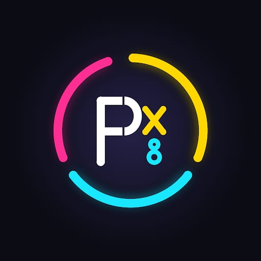

<div align="center">
  

  # ⚡ PavaLED X8

  **Custom RGB color & lighting effect controller for the POCO X8 Pro rear LED ring**

  `v1.1.2` • `No Root Required` • `Powered by Shizuku` • `100% Offline`

  <br />

  [](https://ko-fi.com/ihpavanello)
  [](https://www.instagram.com/ihpavanello?psln=ZWl6bzk0dGlicnFm)
  [](https://github.com/vinicciuspavanellovip-lang/Main/releases)
</div>

---

## ✨ What's New in `v1.1.2`

| Feature | Description |
| :--- | :--- |
| 🎨 **Full RGB Control** | Fine-tune Red, Green, and Blue sliders or pick from 6 quick presets with live ring preview. |
| ⚡ **3 Lighting Modes** | **Solid**, **Pulse**, and **Blink** with real-time animation speed adjustment. |
| 🔄 **Background Engine** | Keeps the LED active while using Camera, TikTok, or games and reclaims the ring automatically. |
| 🚀 **First-Launch Hub** | Guided setup for notifications, Shizuku permission, HyperOS battery settings, and creator links. |
| 🌍 **Multi-Language & UI** | Built-in **English**, **Português**, and **Español** support with **Dark**, **Light**, and **System** themes. |
| 🛡️ **100% Private** | Zero internet, location, camera, microphone, contacts, or storage permissions. |

---

## 🛠️ How to Install & Use

1. **Enable Rear Light:** On your **POCO X8 Pro**, go to **Settings → Additional settings → Rear light effect** and turn it on.
2. **Start Shizuku:** Install and start [Shizuku](https://shizuku.rikka.app/) via Wireless Debugging (no Root required).
3. **Download the APK:** Tap **[Releases](https://github.com/vinicciuspavanellovip-lang/Main/releases)** and install **`PavaLED-X8-v1.1.2.apk`**.
4. **Prevent HyperOS Kill:** Set battery saver for **PavaLED X8** to **No restrictions** and enable **Autostart**.

---

## ☕ Support the Project

**PavaLED X8** is completely free and created by **Viniccius Pavanello ([@ihpavanello](https://www.instagram.com/ihpavanello?psln=ZWl6bzk0dGlicnFm))** out of love for the **POCO** lineup.

- **International Supporters (Ko-fi / PayPal):** [ko-fi.com/ihpavanello](https://ko-fi.com/ihpavanello)
- **Apoiadores no Brasil (Chave Pix Aleatória):**

```text
d1fd33b9-1166-47c4-979e-544b8c335795
